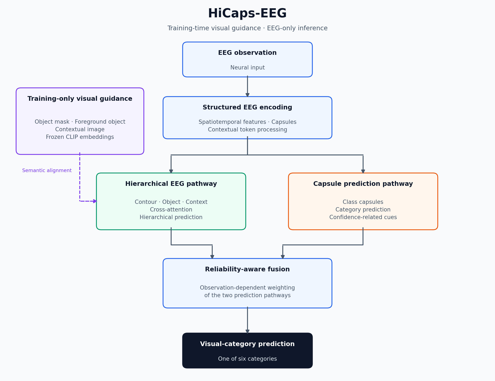

# HiCaps-EEG

## Reliability-Aware Fusion of Hierarchical Semantic and Capsule Representations for EEG Visual Decoding

**Arezoo Pasand · Mohammad Hassan Moradi**  
Department of Biomedical Engineering, Amirkabir University of Technology

**Manuscript status:** Submitted to a conference.  
**Repository scope:** Research documentation and results reported in the submitted manuscript.  
**Code availability:** Source code is not publicly available at this stage.

## Overview

HiCaps-EEG studies how complementary EEG representations can be combined to decode visual categories. It integrates a hierarchical visual-semantic pathway with capsule-based neural representations and uses observation-dependent reliability cues to combine their predictions.

Visual representations from a frozen CLIP encoder guide EEG learning **during training**. At inference, the model uses **EEG only** to predict one of six visual categories.

| Stage | Inputs | Role |
| --- | --- | --- |
| Training | EEG and corresponding stimulus images | Learn category-discriminative EEG representations with visual-semantic guidance |
| Inference | EEG | Predict a visual category through the two EEG prediction pathways and adaptive fusion |

## Method at a glance

*Conceptual summary based on the manuscript. The figure shows the roles of the main components rather than implementation-level dimensions or the exact gate parameterization.*

1. **Structured EEG encoding:** Spatiotemporal convolutions, capsule representations, and contextual token processing capture neural features.
2. **Hierarchical semantic learning:** Contour-, object-, and context-related EEG representations are progressively integrated using cross-attention.
3. **Training-time visual supervision:** Frozen CLIP embeddings of object masks, foreground objects, and contextual images provide semantic targets.
4. **Reliability-aware fusion:** Confidence-related cues determine the contribution of the capsule and hierarchical prediction pathways for each observation.

The hierarchical semantic formulation builds on [ViEEG](https://arxiv.org/abs/2505.12408). The manuscript explores its integration with capsule-based representations and reliability-aware prediction fusion.

[Read the method summary →](docs/method.md)

## Dataset and evaluation

Experiments use the public visual EEG dataset introduced by [Kaneshiro et al. (2015)](https://doi.org/10.1371/journal.pone.0135697), available through the [Stanford Digital Repository](https://purl.stanford.edu/bq914sc3730).

The original dataset contains recordings from **10 participants** viewing **72 images** from six categories: Human Body, Human Face, Animal Body, Animal Face, Fruit/Vegetable, and Inanimate Object.

| Protocol | Generalization target | Outer folds reported |
| --- | --- | --- |
| Stimulus-wise | Previously unseen stimulus images within the same six categories | 6 |
| Subject-wise | Previously unseen participants | 5 |

Stimulus-wise evaluation concerns new image identities, not new category labels. The manuscript reports keeping the corresponding generalization units separate and reserving outer-test data for final evaluation.

## Main reported results

| Protocol | Reported accuracy (%) | Six-class chance (%) |
| --- | ---: | ---: |
| Stimulus-wise | **59.39 ± 5.07** | 16.67 |
| Subject-wise | **36.86 ± 4.09** | 16.67 |

*Values are outer-fold summaries reproduced from Section III-A of the submitted manuscript. The two protocols assess different forms of generalization.*

### Contribution of reliability-aware fusion

| Configuration | Stimulus-wise accuracy (%) | Subject-wise accuracy (%) |
| --- | ---: | ---: |
| Hierarchical tri-view configuration | 57.92 | 34.44 |
| With reliability-aware fusion | **59.39** | **36.86** |
| Difference (percentage points) | **+1.47** | **+2.42** |

These comparisons are ablations within the study, not a benchmark comparison with external methods.

[Full reported ablations and temporal results →](docs/results.md)

## Temporal decoding

*Redrawn from the nine single-window accuracy values in Table II. The highest reported single-window accuracy is 49.86% at 240–320 ms. Single-window results are separate from the full-response results above.*

## Available materials

- Method and evaluation summaries.
- Reported overall, ablation, and temporal results in CSV format.
- A simplified architecture diagram and a plot of reported temporal results.

[Code and material availability →](CODE_AVAILABILITY.md)

## Limitations

Evaluation is limited to one visual EEG dataset with ten participants. Generalization to unseen participants remains challenging. Broader validation, more detailed reliability modelling, and subject adaptation are directions discussed in the manuscript.

The current documentation release does not include executable experiments, checkpoints, split assignments, or raw predictions.

## Manuscript and contact

**Title:** HiCaps-EEG: Reliability-Aware Fusion of Hierarchical Semantic and Capsule Representations for EEG Visual Decoding  
**Authors:** Arezoo Pasand and Mohammad Hassan Moradi  
**Status:** Submitted to a conference.

**Research contact:** [arezoo.pasand@aut.ac.ir](mailto:arezoo.pasand@aut.ac.ir)
