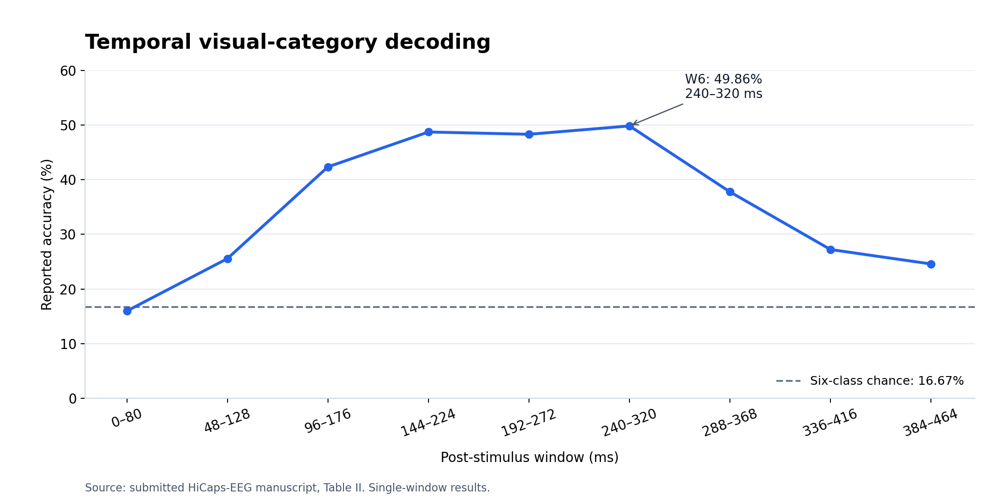

# Reported results

All values in this page are transcribed from the submitted manuscript. The CSV files contain aggregate reported values; they do not contain trial-level predictions or independent reproduction results.

## Overall performance

| Protocol | Reported accuracy (%) | Outer folds |
| --- | ---: | ---: |
| Stimulus-wise | 59.39 ± 5.07 | 6 |
| Subject-wise | 36.86 ± 4.09 | 5 |

The ± values are reproduced as presented in Section III-A. They are not relabelled here as confidence intervals or repeated-seed statistics. The nominal chance level for six balanced categories is 16.67%.

Machine-readable values: [overall.csv](../results/overall.csv).

## Ablation results

| Variant | Configuration | Stimulus-wise accuracy (%) | Subject-wise accuracy (%) |
| --- | --- | ---: | ---: |
| A | No visual supervision | 56.81 | 33.44 |
| B | Tri-view CLIP, without hierarchical routing | 58.06 | 34.40 |
| C | Hierarchical tri-view configuration | 57.92 | 34.44 |
| D | Hierarchical tri-view with reliability-aware fusion | 59.39 | 36.86 |

Source: Table III. This table retains reported mean accuracies without inferring additional statistical quantities.

Variant D minus variant C yields +1.47 percentage points for stimulus-wise evaluation and +2.42 percentage points for subject-wise evaluation. These are within-study ablations. No matched external-method benchmark or statistical significance test is established by this table.

Machine-readable values: [ablation.csv](../results/ablation.csv).

## Temporal decoding

The manuscript evaluates nine overlapping temporal windows of 80 ms with a 48 ms step.

| Window | Interval (ms) | Accuracy (%) |
| --- | --- | ---: |
| W1 | 0–80 | 15.97 |
| W2 | 48–128 | 25.56 |
| W3 | 96–176 | 42.36 |
| W4 | 144–224 | 48.75 |
| W5 | 192–272 | 48.33 |
| W6 | 240–320 | 49.86 |
| W7 | 288–368 | 37.78 |
| W8 | 336–416 | 27.22 |
| W9 | 384–464 | 24.58 |

Source: Table II. The peak single-window accuracy is at W6. These measurements should be distinguished from the full-response experiment.

The chart is redrawn from the tabulated values. No error bars are inferred from Table II.

Machine-readable values: [temporal.csv](../results/temporal.csv).

## Interpretation and limits

- The subject-wise protocol shows lower accuracy than the stimulus-wise protocol, indicating the difficulty of transfer to unseen participants in this experiment.
- The fusion improvement is larger under subject-wise evaluation in the reported ablations.
- The temporal experiment suggests stronger category information during intermediate post-stimulus windows in this dataset.
- The results do not establish generalization to additional datasets, unseen categories, video, or animal behaviour.
